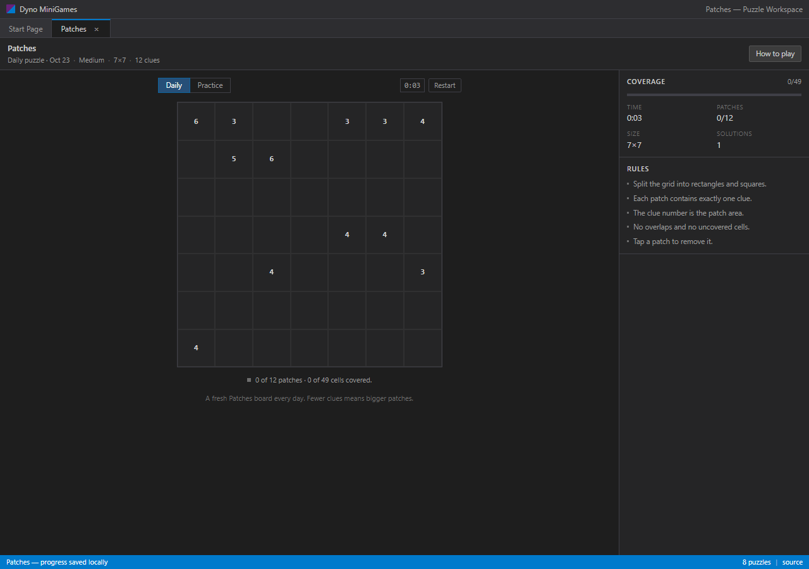
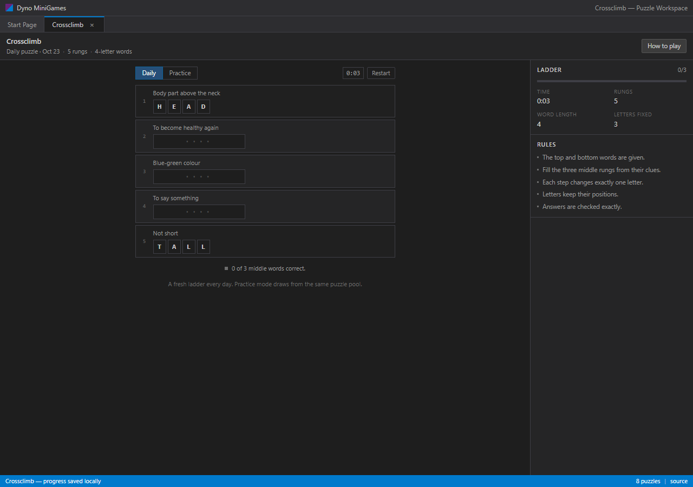
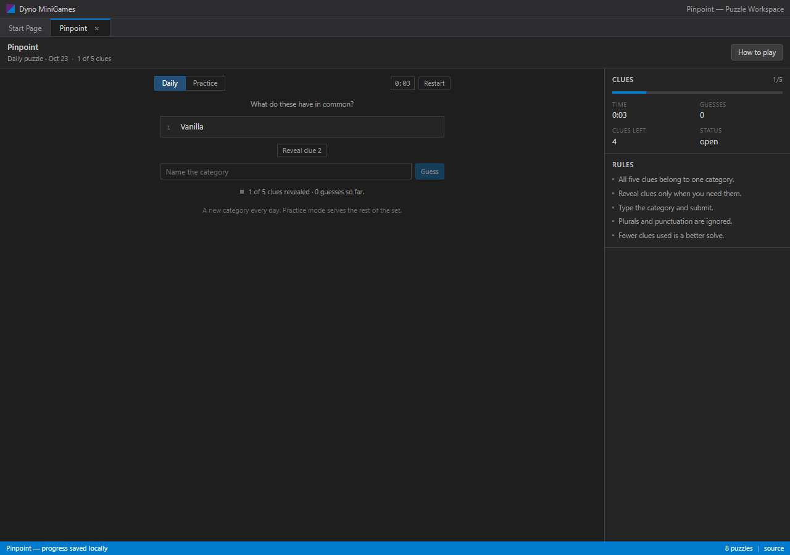
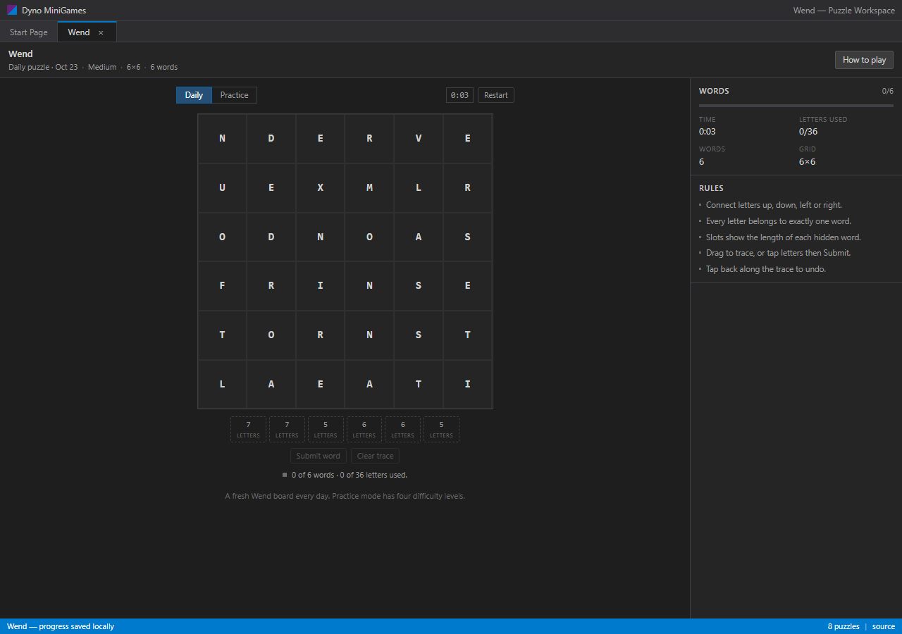

# Dyno MiniGames

**Live:** https://realkhoa.github.io/dyno-minigames/

All eight LinkedIn-style daily puzzles in a Visual Studio-flavoured workspace:
document tabs, tool windows and a status bar, all flat and dark. Static site, no
backend, no accounts — every board is generated or curated locally and progress
stays in the browser.


## Games

| Game | Idea | Board |
| --- | --- | --- |
| **Tango** | Balance suns and moons | 6×6, seeded generator |
| **Queens** | One queen per row, column and colour region | 6×6 – 9×9 |
| **Zip** | One path through every cell, numbers in order | 5×5 – 7×7 |
| **Mini Sudoku** | 6×6 sudoku with 2×3 boxes | 6×6, unique solution |
| **Patches** | Rectangles sized by area clues | 6×6 – 8×8 |
| **Crossclimb** | Word ladder, one letter per rung | 16 ladders |
| **Pinpoint** | Five clues, one category | 32 categories |
| **Wend** | Tracing words that use every letter | 5×5 – 7×7 |










## Rules

**Tango** — fill every cell with a sun or moon. Each row and column holds three
of each, no three identical symbols may touch in a line, `=` links must match and
`×` links must differ. Cells with a lock are fixed clues.

**Queens** — place exactly *N* queens on an *N*×*N* board: one per row, column and
coloured region, and no two may touch, not even diagonally. The region map is the
whole puzzle. Marks are notes for cells you have ruled out.

**Zip** — draw one continuous line through every cell, starting on 1, ending on
the highest number and hitting the checkpoints in ascending order. Drag across
cells, or tap them one at a time; tap back along the path to undo.

**Mini Sudoku** — every row, column and 2×3 box holds 1–6 exactly once. Grey
digits are clues. Select a cell, then tap a number; tap it again to clear.

**Patches** — split the grid into rectangles. Each rectangle holds exactly one
clue, and that number is its area. No overlaps, no uncovered cells. Drag corner
to corner or tap two opposite corners; tap a patch to remove it.

**Crossclimb** — a five-rung word ladder. The top and bottom words are given;
fill the three middle rungs from their clues. Each rung changes exactly one
letter from its neighbour.

**Pinpoint** — five clues share one hidden category. Reveal clues one at a time,
then name the category. Case, punctuation and plurals are ignored.

**Wend** — trace hidden words through orthogonally adjacent letters. Every letter
belongs to exactly one word, and the lengths of the hidden words are shown under
the board. Any valid dictionary word of the right length is accepted.

## Controls

| Action | How |
| --- | --- |
| Tango | Click to cycle sun / moon; `1`/`S`, `2`/`M`, `0` clears |
| Queens | Queen / Mark tool, right-click to mark, `1`/`2`/`0` |
| Zip / Wend | Drag or tap adjoining cells; tap backwards to undo |
| Sudoku | Select a cell, then a pad number or `1`–`6` |
| Patches | Drag or tap two opposite corners |
| Crossclimb | Type the rung, `Enter` jumps to the next one |
| Keyboard | Arrow keys move, `Backspace` clears |

Progress and timers are saved in `localStorage` per puzzle. Daily puzzles are
keyed by the local date; practice boards get a random seed.

## Generation

Every board comes from a deterministic seed (`mulberry32` + string hash), so a
daily puzzle is identical for everyone with no backend.

- **Tango** — build a valid grid, attach `=`/`×` links, then remove clues while
  the number of completions stays inside a difficulty band. Deadly keeps exactly
  one solution; every puzzle keeps at least three locked clues.
- **Queens** — place a random legal queen set, grow one connected region per
  queen, and keep the tightest of ~180 candidate partitions. 6×6 boards come out
  unique; larger boards keep a handful of solutions and accept any valid one.
- **Zip** — random Hamiltonian path (Warnsdorff DFS); checkpoints are scattered
  at random along it, and walls are dropped on edges the path never uses. Boards
  run from 6×6 with 9 numbers up to 7×7 with 4 numbers and 10 walls.
- **Patches** — fill the board from the top-left-most free cell with rectangles
  of 2–8 cells, which gives small irregular patches instead of guillotine cuts.
  A Shikaku solver counts the tilings and generation keeps a board with exactly
  one: 10 patches on 6×6 up to 16 on 9×9.
- **Mini Sudoku** — fill a 6×6 grid, then remove clues while the solver still
  finds exactly one solution.
- **Wend** — cut a Hamiltonian path into words of the target lengths and fill
  each segment from the bundled word list (4–8 letters).
- **Crossclimb** and **Pinpoint** use curated content: 16 ladders and 32
  categories, validated by tests.

Generation costs a few milliseconds per board (Queens 9×9 is the slowest at
~65 ms).

## Stack

Vite 8 + React 19 + TypeScript. No runtime dependencies beyond React. Hash
routing keeps GitHub Pages happy. CSS is hand-written; no UI kit.

```
src/
  games/tango|queens|zip|sudoku|patches|wend/
      engine.ts     rules, solvers, generators
      *Game.tsx     one screen per game
  games/crossclimb/ puzzles.ts (curated ladders) + engine.ts
  games/pinpoint/   categories.ts (curated set) + engine.ts
  components/GameShell.tsx    shared header, help dialog, layout, footer
  components/                 icons + modal
  pages/Dashboard.tsx         game shelf
  lib/                        seeded random, grid paths, hash router, storage
scripts/
  *.test.ts       engine and data checks
  ui-check.ts     headless Chrome end-to-end run over every game
```

## Local development

```bash
npm install
npm run dev        # http://localhost:5173
npm run build      # type-check + production build into dist/
npm run preview    # serve the production build
npm test           # engine and data tests (Node 22+)
```

The UI check needs a preview server plus Chrome; it plays through all eight
games:

```bash
npm run preview -- --port 4173
node --experimental-strip-types scripts/ui-check.ts
```

## Deploy to GitHub Pages

`.github/workflows/deploy.yml` builds and publishes `dist/` on every push to
`main`.

1. In **Settings → Pages → Build and deployment**, set **Source** to
   **GitHub Actions**.
2. Push to `main`. The site appears at `https://<user>.github.io/<repo>/`.

`vite.config.ts` uses `base: "./"`, so the same build works for a project page, a
user page, or a custom domain.

## Credits

- Word list for Wend: [google-10000-english](https://github.com/first20hours/google-10000-english),
  filtered to 4–8 letter words.
- Game formats inspired by LinkedIn Games. This is an independent fan project,
  not affiliated with LinkedIn.

## Roadmap

- More Crossclimb ladders and Pinpoint categories.
- Streaks and per-game stats on the dashboard.
- Optional easy mode for Wend (highlight the first letter of each word).

---

### Tiếng Việt

- `npm install` → `npm run dev` chạy local, `npm run build` tạo bản tĩnh.
- Đẩy code lên GitHub, vào **Settings → Pages**, chọn **Source: GitHub Actions**;
  workflow có sẵn sẽ tự build và deploy.
- Đủ **8 game** giống LinkedIn: Tango, Queens, Zip, Mini Sudoku, Patches,
  Crossclimb, Pinpoint, Wend. Đề sinh ngay trên trình duyệt theo seed (ngày cho
  puzzle daily), không cần server; riêng Crossclimb và Pinpoint dùng bộ nội dung
  viết tay.
- Tango quyết định độ khó bằng số lời giải (Deadly đúng 1); Queens càng lớn càng
  khó; Zip/Wend vẽ đường; Sudoku mỗi đề đúng 1 lời giải; Patches chia hình chữ
  nhật theo diện tích.
