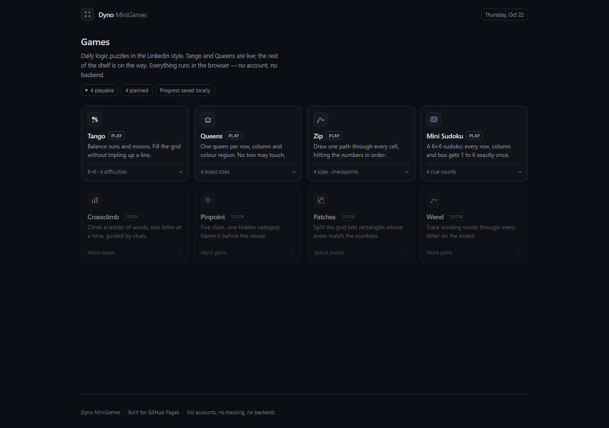
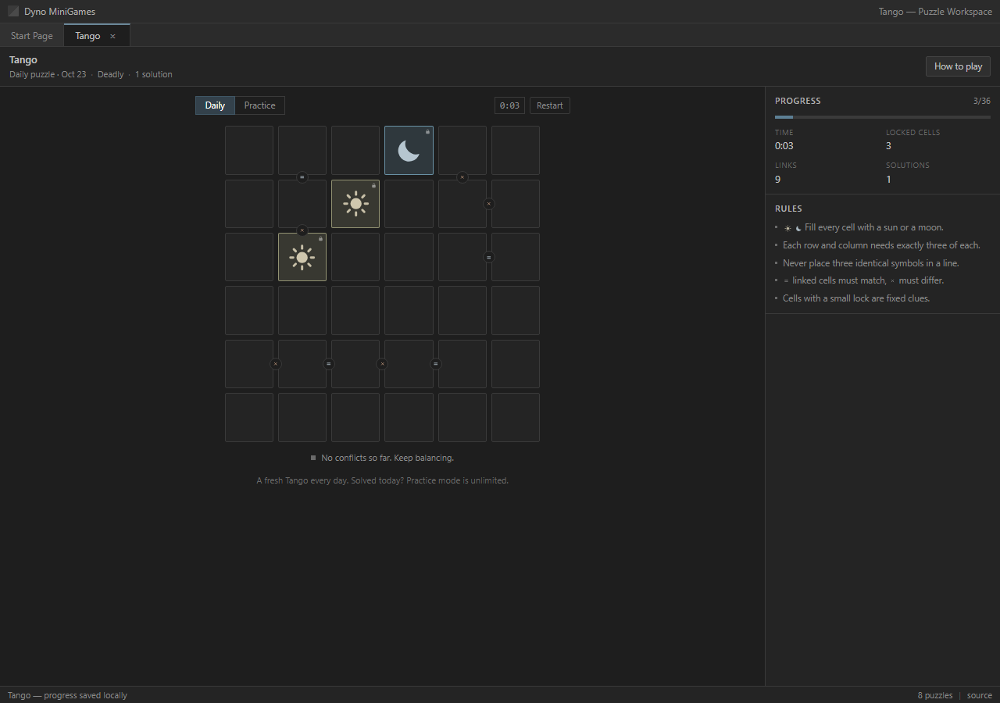
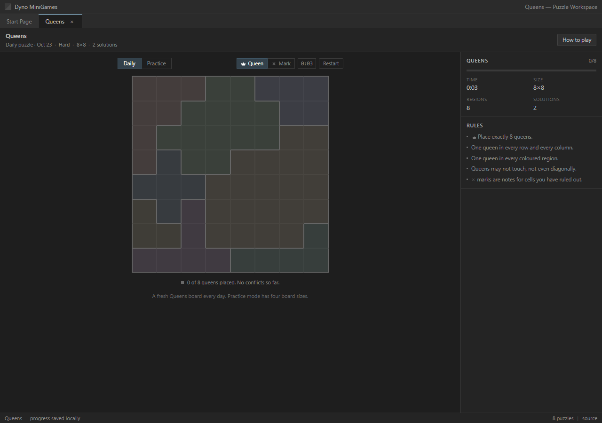
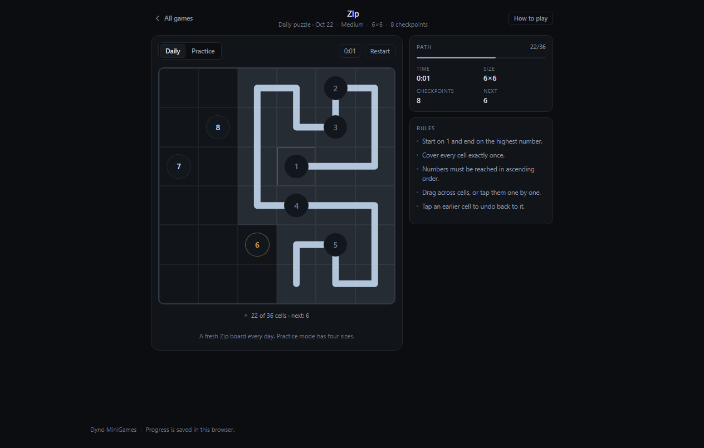
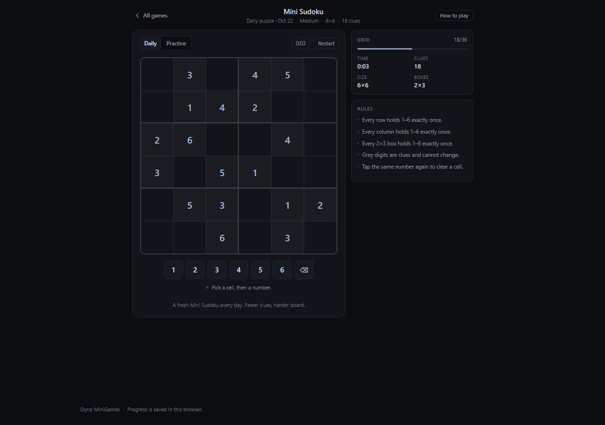

# Dyno MiniGames

**Live:** https://realkhoa.github.io/dyno-minigames/

A tiny shelf of daily logic mini games in the LinkedIn style, served as a static
site on GitHub Pages. The dashboard is the home screen; each game lives on its
own hash route so the build works from any repository path without server
rewrites.



## Games

| Game | Status | Idea |
| --- | --- | --- |
| **Tango** | live | Balance suns and moons on a 6×6 grid |
| **Queens** | live | One queen per row, column and colour region |
| **Zip** | live | One path through every cell, numbers in order |
| **Mini Sudoku** | live | 6×6 sudoku with 2×3 boxes |
| Crossclimb | planned | Word ladder with clues |
| Pinpoint | planned | Five clues, one category |
| Patches | planned | Rectangles sized by area clues |
| Wend | planned | Winding word paths covering every letter |









## Tango

- Fill every cell with a **sun** or a **moon**.
- Every row and column holds exactly **three suns and three moons**.
- Never three identical symbols in a row or column.
- `=` links force two neighbours to match; `×` links force them to differ.
- Cells with a lock are **fixed clues** and cannot be edited.
- Any grid that satisfies all rules wins.

## Queens

- Place exactly *N* queens on an *N*×*N* board.
- One queen per row, per column, and per coloured region.
- Queens may never touch — not even diagonally.
- There are no pre-filled clues: the region map is the whole puzzle.
- Use the **Mark** tool (or right-click) to note cells you have ruled out.
- Any valid arrangement wins; the header shows how many exist.

## Zip

- Start on **1** and finish on the highest number.
- Draw one continuous line through **every cell**, each exactly once.
- Numbers must be reached in ascending order; out-of-order checkpoints are blocked.
- Drag across cells, or tap them one after another.
- Tap an earlier cell on the path to undo back to it.

## Mini Sudoku

- A 6×6 grid split into six **2×3 boxes**.
- Every row, column and box contains the digits 1–6 exactly once.
- Grey digits are clues and cannot be changed.
- Tap a cell, then a number; tap the same number again to clear it.
- Every board is generated with exactly one solution.

## Controls

| Action | How |
| --- | --- |
| Tango | Click to cycle sun / moon; `1`/`S`, `2`/`M`, `0` clears |
| Queens | Queen / Mark tool, right-click to mark, `1`/`2`/`0` |
| Zip | Drag or tap adjoining cells; tap backwards to undo |
| Sudoku | Select a cell, then a pad number or `1`–`6` |
| Keyboard | Arrow keys move, `Backspace` clears |
| Restart | Toolbar button |

Progress and the timer are saved in `localStorage`, per puzzle. Daily puzzles are
keyed by the local date; practice puzzles get a random seed and a fresh board.

## Puzzle generation

Every board is generated in the browser from a deterministic seed
(`mulberry32` + string hash), so a daily puzzle is identical for everyone with no
backend, and any seed reproduces the same board.

**Tango** — build a valid full grid, attach `=` / `×` links, then remove clues
one at a time while the number of completions stays inside the difficulty band.
The final count is verified with a backtracking solver, and the stored solution
always exists, so a puzzle can never be unsolvable.

| Difficulty | Solutions | Links |
| --- | --- | --- |
| Easy | 6–14 | ~3 |
| Medium | 4–5 | ~5 |
| Hard | 2–3 | ~7 |
| **Deadly** | **exactly 1** | ~9 |

**Queens** — place a random legal queen set, grow one connected region per queen
by random expansion, then keep the tightest board found across ~180 attempts
(early exit on a unique solution). Random, crooked regions constrain the solver
far more than tidy balanced blobs.

| Difficulty | Board | Typical solutions |
| --- | --- | --- |
| Easy | 6×6 | 1 (always unique in testing) |
| Medium | 7×7 | 1–3 |
| Hard | 8×8 | 1–6 |
| **Deadly** | 9×9 | 1–21 |

**Zip** — grow a random Hamiltonian path with a Warnsdorff-ordered DFS, then
place checkpoints along it at stratified positions (1 at the start, the highest
number at the end). Every board ships with a valid full path; the player may draw
any path that follows the rules.

**Mini Sudoku** — fill a random valid 6×6 grid, then remove clues one at a time
while a backtracking solver still finds exactly one solution. Difficulty is the
number of clues kept: 22 / 18 / 14, or fully minimal (9–12) for Deadly.

Generation costs well under 25 ms per board on a laptop; engine tests live in
`scripts/*.test.ts` and run with `npm test`.

## Stack

Vite 8 + React 19 + TypeScript. No runtime dependencies beyond React. Hash
routing keeps GitHub Pages happy. CSS is hand-written; no UI kit.

```
src/
  games/tango/engine.ts       rules, solver, generator, difficulty bands
  games/queens/engine.ts      placement solver, region growth, generator
  games/zip/engine.ts         Hamiltonian paths, checkpoints, path validation
  games/sudoku/engine.ts      6x6 solver, clue carving, conflicts
  games/*/*Game.tsx           one screen per game
  components/GameShell.tsx    shared game chrome (header, help, layout, footer)
  components/                 icons + modal
  pages/Dashboard.tsx         game shelf
  lib/                        seeded random, hash router, storage helpers
scripts/
  tango|queens|zip|sudoku.test.ts   engine checks
  ui-check.ts                       headless Chrome end-to-end checks
```

## Local development

```bash
npm install
npm run dev        # http://localhost:5173
npm run build      # type-check + production build into dist/
npm run preview    # serve the production build
npm test           # engine tests (Node 22+)
```

The UI check needs a running preview server plus Chrome:

```bash
npm run preview -- --port 4173
node --experimental-strip-types scripts/ui-check.ts
```

## Deploy to GitHub Pages

The workflow in `.github/workflows/deploy.yml` builds and publishes `dist/` on
every push to `main`.

1. In **Settings → Pages → Build and deployment**, set **Source** to
   **GitHub Actions**.
2. Push to `main`. The site appears at `https://<user>.github.io/<repo>/`.

`vite.config.ts` uses `base: "./"`, so the same build works for a project page, a
user page, or a custom domain without editing the repo name.

## Roadmap

- Crossclimb, Pinpoint, Patches, Wend.
- Per-game stats and streaks on the dashboard.

---

### Tiếng Việt

- `npm install` → `npm run dev` chạy local, `npm run build` tạo bản tĩnh.
- Đẩy code lên GitHub, vào **Settings → Pages**, chọn **Source: GitHub Actions**;
  workflow có sẵn sẽ tự build và deploy.
- Đề được sinh ngay trên trình duyệt theo seed (ngày cho puzzle daily), không
  cần server.
- **Tango**: độ khó theo số lời giải — Easy nhiều lời giải, Medium 4–5, Hard 2–3,
  **Deadly đúng 1 lời giải**; luôn có tối thiểu 3 ô khoá không sửa được.
- **Queens**: đặt N quân hậu trên bàn N×N, mỗi hàng/cột/vùng màu đúng một quân,
  không quân nào chạm nhau kể cả chéo. Vùng màu là toàn bộ đề bài.
- **Zip**: một đường liền mạch phủ mọi ô, đi qua các số theo thứ tự tăng dần.
- **Mini Sudoku**: 6×6, mỗi hàng/cột/hộp 2×3 có đủ 1–6; mỗi đề đúng 1 lời giải.
